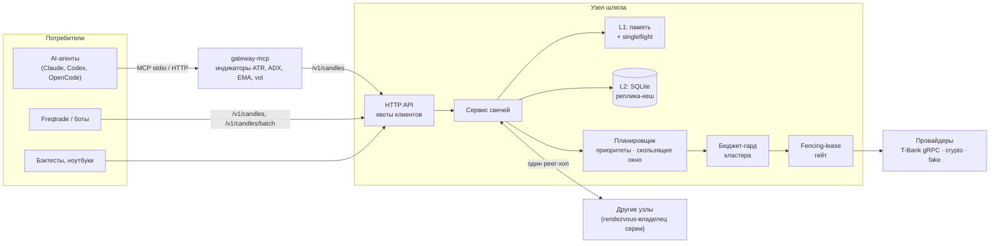
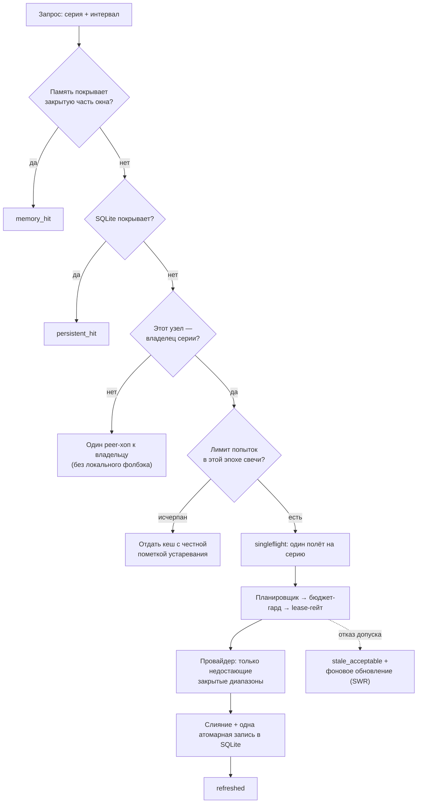

# Market Data Gateway

**Шлюз рыночных данных на Go: один кеширующий, лимитированный и отказоустойчивый
вход к биржевым свечам для торговых ботов, исследовательских конвейеров и
AI-агентов.**


> English version: [README.en.md](README.en.md) · Непонятный термин? — [словарь](DOC/terms/README.md)

---

## Задача, которую решает проект

Десятки потребителей — торговые боты (Freqtrade), бэктесты, ноутбуки,
AI-агенты — хотят свечи одного и того же брокера (T-Bank Invest API). Если
каждый ходит к брокеру сам, получается:

- **лимиты API сгорают** — одинаковые запросы дублируются, холодный старт
  80 серий бьёт по API одновременно;
- **данные расходятся** — у каждого свой кеш и своё понимание «последней свечи»;
- **сбой брокера = сбой всех** — нет общей деградации и честного «устаревшего» ответа.

Market Data Gateway ставит между потребителями и провайдером **одну
архитектурную границу**: каждая свеча запрашивается у провайдера один раз,
бюджет запросов гарантирован математически, а при сбое клиент получает
кешированные данные с явной [пометкой свежести](DOC/terms/cache.md#свежесть) — а не пустой ответ и не
«свежие» данные, которые на самом деле старые.

Сервис **только читает**: в нём нет ни одного вызова заявок или торговых
операций — это граница архитектуры, а не настройка.

---

## Архитектура одним взглядом



| Уровень | Что делает | Где в коде |
|---|---|---|
| Клиентский API | свечи, батчи, health/ready, Prometheus-метрики | `internal/httpapi` |
| Сервис | путь запроса: кеш → владелец → эпоха → singleflight → провайдер | `internal/service` |
| Кеш | память с учётом покрытия интервалов + singleflight | `internal/cache` |
| Хранилище | SQLite-реплика, свои миграции, fail-closed на чужую схему | `internal/storage` |
| Допуск к API | планировщик, приоритеты, квоты, повторы, drain | `internal/ratelimit` |
| Бюджет | инвариант бюджета на группу учётных данных | `internal/budget` |
| Кластер | rendezvous-маршрутизация, peer API, fencing-аренда | `internal/routing`, `internal/cluster`, `internal/peerapi`, `internal/lease` |
| Провайдеры | T-Bank (gRPC), crypto (CCXT-подобный), детерминированный fake | `internal/provider` |
| AI-слой | MCP-сервер и чистые функции индикаторов | `cmd/mcp`, `internal/indicators` |

Около 18 тыс. строк Go, сборка [без CGO](DOC/terms/reliability.md#cgo-free) (`CGO_ENABLED=0`), один статический бинарник.

---

## Путь одного запроса

Каждый запрос свечей проходит фиксированный конвейер; на каждом шаге может
завершиться раньше — и чем раньше, тем дешевле.



---

## 1. Закрытие свечей: не скачивать то, что уже есть

Ключевая идея — **кешируется не набор свечей, а [покрытие интервалов](DOC/terms/candles.md#покрытие-интервала)**.
Отсутствующая свеча (например, ночью нет сделок) и непокачанный интервал —
разные вещи, и шлюз их не путает (`cache.Range`, `LookupResult.Missing`).
Отсюда несколько механизмов:

- **Докачка только дыр.** Запрос раскладывается на уже покрытые и
  недостающие диапазоны; провайдеру уходят только `Missing`. Клиент может
  каждый раз просить «последние 500 баров» — к брокеру уйдёт одна новая свеча.
- **[Эпоха закрытой свечи](DOC/terms/candles.md#эпоха-обновления).** Граница обновления серии — открытие текущего бара
  (`refreshEpochMS`). Пока новый бар не закрылся, повторный опрос не порождает
  вызовов провайдера сверх лимита попыток на эпоху
  (`max_refresh_attempts_per_epoch`, по умолчанию 2: одна — на обычное
  обновление, вторая — на задержку публикации у брокера).
- **[Формирующаяся свеча](DOC/terms/candles.md#закрытая-и-формирующаяся-свеча) не форсирует запрос.** Полнота окна оценивается только
  по закрытой части (`epochAwareLookup`): «живой» бар, который провайдер мог
  ещё не опубликовать, не ломает кеш-хит. Флаг `include_incomplete` решает,
  показывать ли его клиенту.
- **[Грейс публикации](DOC/terms/candles.md#грейс-публикации).** `publication_grace_ms` сдвигает границу эпохи: только
  что закрытый бар не дёргается у провайдера, пока тот его обычно ещё не
  выложил.
- **Учёт по сигнатуре диапазона.** Одинаковые повторные опросы делят один лимит
  попыток, разные диапазоны качаются независимо — бюджет не сгорает от
  клиента, который опрашивает раз в секунду.

Итог: частота обращений к брокеру определяется **таймфреймом рынка**, а не
количеством клиентов и частотой их опроса.

---

## 2. Режимы кеширования

Двухуровневый кеш с явными состояниями: каждый ответ говорит, откуда данные
и насколько они свежие.

| `cache_status` | Смысл |
|---|---|
| `memory_hit` | окно целиком в памяти узла |
| `persistent_hit` | окно поднято из SQLite (после рестарта или вытеснения) |
| `singleflight_join` | запрос присоединился к уже идущему полёту той же серии |
| `refreshed` | недостающие диапазоны докачаны у провайдера и сохранены |
| `miss` | обновить не удалось — отдан последний снимок из кеша или честный отказ (см. `freshness`) |

| `freshness` | Смысл |
|---|---|
| `fresh` | данные актуальны для текущей эпохи |
| `stale_acceptable` | провайдер недоступен или бюджет исчерпан, кеш моложе `MaxStaleAge` — отдаём с типизированной причиной |
| `stale_rejected` | кеш слишком старый — честный отказ вместо вводящих в заблуждение данных |

Поверх этого:

- **[Singleflight](DOC/terms/cache.md#singleflight) на серию.** Сто одновременных запросов одной серии — один
  вызов провайдера; присоединившиеся не тратят бюджет попыток.
- **[Stale-while-revalidate](DOC/terms/cache.md#stale-while-revalidate).** Если ответ пришлось отдать устаревшим, ставится
  ровно одно дедуплицированное фоновое обновление на серию (ограниченная
  очередь, низший приоритет, ограниченные повторы) — восстановление не зависит
  от того, будет ли клиент переспрашивать.
- **[SQLite-реплика](DOC/terms/cache.md#реплика-кеш).** Чистый Go-драйвер без CGO, ограниченное хранение
  (`cache_retention_ms`), собственная цепочка миграций только вперёд; более
  новая схема на диске, чем знает бинарник, — отказ старта.
- **Реплики от владельца.** В кластере ответы peer-узла сохраняются как
  read-only реплики тем же путём, что и локальные.
- **Контролируемый [прогрев](DOC/terms/cache.md#прогрев).** После старта шлюз дозированно, с приоритетом
  warmup, прогревает вселенную инструментов — холодный старт Freqtrade
  находит тёплый кеш вместо 80 одновременных промахов.

---

## 3. Оптимизация нагрузки на провайдера

Лимит брокера — общий ресурс, и шлюз защищает его на нескольких уровнях:

1. **[Батчи](DOC/terms/load.md#батч-и-fan-out).** `POST /v1/candles/batch` — до `max_batch_items` серий за один
   запрос, с ограниченным параллелизмом (`batch_fan_out`), ошибки по каждой
   позиции отдельно: одна плохая серия не валит остальные.
2. **Планировщик с приоритетами.** Фиксированный пул воркеров, ограниченная
   очередь, два приоритета: `live refresh` (клиенты) всегда впереди `warmup`
   (прогрев и фоновое восстановление), warmup вытесняется первым.
3. **[Скользящее окно](DOC/terms/load.md#скользящее-окно), а не «ведро».** Бюджет узла ограничивает число попыток
   в *любом* окне длиной минуту — без всплесков на границе минуты.
4. **[Квоты клиентов](DOC/terms/load.md#квота-клиента).** `per_client_quota_per_minute` и ограниченное число
   отслеживаемых клиентов — один шумный потребитель не съедает общий лимит.
5. **Повторы с [джиттером](DOC/terms/load.md#джиттер)** и ограничением числа попыток ([backoff](DOC/terms/load.md#backoff)), корректный [drain](DOC/terms/load.md#drain) при
   остановке.
6. **[Бюджет](DOC/terms/load.md#бюджет) кластера как [инвариант](DOC/terms/reliability.md#инвариант).**
   `sum(node_hard_budgets_per_minute) <= safe_budget_per_minute` проверяется
   при загрузке конфига (небезопасный конфиг — сервис не стартует) и ещё раз
   перед *каждым* вызовом провайдера. Если брокер сообщил о сокращении лимита
   ниже настроенной суммы, upstream-работа защёлкивается закрытой до рестарта.
7. **[Capacity plan](DOC/terms/load.md#capacity-plan)** (`off` / `shadow` / `enforce`): прогноз нагрузки на
   старте; `shadow` только экспортирует метрики, `enforce` не пускает в
   ready неосуществимый план. Подробнее — [DOC/capacity_plan.md](DOC/capacity_plan.md),
   [ADR-007](DOC/adr/ADR-007-capacity-planning.md).

---

## 4. Кластер без split-brain

> Термины раздела: [словарь кластера](DOC/terms/cluster.md).

Шлюз масштабируется горизонтально, сохраняя главный инвариант:
**у каждой серии не больше одного узла, который ходит к провайдеру.**

- **[Weighted rendezvous hashing](DOC/terms/cluster.md#weighted-rendezvous-hashing)** по каноническому `SeriesKey` с солью
  `routing_version`: все узлы независимо и детерминированно вычисляют одного
  primary и standby. Векторы зафиксированы golden-тестами.
- **Ровно один [peer-хоп](DOC/terms/cluster.md#peer-хоп).** Не-владелец делает один ограниченный по времени
  запрос к владельцу и **никогда** не уходит к провайдеру сам. Владелец
  никогда не проксирует дальше — циклы структурно невозможны.
- **Приватный peer API** с аутентификацией узлов (constant-time сравнение),
  проверкой версии маршрутизации и владельца — для батчей поэлементно.
- **Автоматический [failover](DOC/terms/cluster.md#failover) через [fencing-токены](DOC/terms/cluster.md#fencing-токен).** [Standby](DOC/terms/cluster.md#primary-и-standby) забирает серию
  только получив аренду со строго большим токеном, подтверждённым большинством
  [свидетелей](DOC/terms/cluster.md#кворум-и-свидетели). Узел с устаревшим токеном отвергается; нет кворума — нет
  вызова провайдера. Деградация никогда не расширяет права владения.
  Контракт и fault-тесты: [DOC/market_data_gateway_failover.md](DOC/market_data_gateway_failover.md).

```bash
make smoke-cluster2   # два узла на приватном IPv4
make smoke-cluster3   # три узла
```

---

## 5. MCP: рыночные данные для AI-агентов

`gateway-mcp` — read-only сервер [Model Context Protocol](DOC/terms/protocols.md#mcp).
Это тонкий клиент шлюза: к провайдеру он не ходит, поэтому кеш, singleflight
и бюджет-гард действуют и для агентов. Индикаторы — чистые функции с
[golden-тестами](DOC/terms/reliability.md#golden-тест) ([Wilder ATR](DOC/terms/market.md#atr), [ADX](DOC/terms/market.md#adx), [EMA](DOC/terms/market.md#ema), [realized volatility](DOC/terms/market.md#realized-volatility)).

| Инструмент | Что возвращает |
|---|---|
| `get_candles` | OHLCV (десятичные строки), свежесть, флаг незакрытой свечи |
| `get_volatility` | ATR, ATR % цены, realized vol (за бар и годовая), перцентиль ATR, метка `low` / `normal` / `high` |
| `get_trend` | EMA 20/50/200, наклон EMA20, ADX(14), метка `up` / `down` / `flat` и сила тренда |
| `market_snapshot` | до 20 инструментов за один батч-вызов: цена, изменение, метки волатильности и тренда |
| `gateway_status` | health, ready, сборка, узел, площадки, таймфреймы |

Промпт `market_brief(symbol, timeframe)` просит модель вызвать тренд и
волатильность и написать краткую сводку. Ошибки [типизированы](DOC/terms/reliability.md#типизированная-ошибка):
`INVALID_REQUEST`, `UNKNOWN_SYMBOL`, `GATEWAY_UNAVAILABLE`, `INSUFFICIENT_DATA`.

Транспорты: [`stdio`](DOC/terms/protocols.md#stdio) для локальных агентов и [Streamable HTTP](DOC/terms/protocols.md#streamable-http) (`/mcp`) для
удалённых — только с [bearer-токеном](DOC/terms/protocols.md#bearer-токен) и только на loopback/приватном адресе.

```bash
claude mcp add market-data -e MARKET_DATA_GATEWAY_URL=http://127.0.0.1:8088 -- ./build/gateway-mcp
```

Настройка Codex, OpenCode и HTTP-транспорта — в [README.en.md](README.en.md#mcp-server).

---

## 6. Фьючерсы и граница возможностей

- **Идентичность серии — [физический контракт](DOC/terms/market.md#физический-контракт)** (UID конкретной экспирации), а
  не логический тикер: история `GOLD-12.26` никогда не смешается со следующим
  контрактом.
- **[Алиас](DOC/terms/market.md#алиас) — только вход для разрешения**: в одном снимке реестра он указывает
  ровно на один контракт; алиас на двух контрактах — ошибка конфигурации.
- Ответ несёт метаданные инструмента: тип, единицы цены (`points` для
  фьючерсов, валюта для акций), единицы объёма (`lots`), экспирацию.
- **[Ролл](DOC/terms/market.md#ролл) без рестарта**: реестр инструментов перечитывается из файла,
  кандидат валидируется целиком, сохраняется через [атомарный rename](DOC/terms/reliability.md#атомарный-rename) и
  подменяется под блокировкой; битый файл отвергается, текущий реестр остаётся.
- **Никаких тихих фолбэков**: всё вне границы (стаканы, стримы, заявки) —
  типизированная ошибка `UNSUPPORTED_CAPABILITY`, неизвестный символ —
  `UNKNOWN_SYMBOL` ещё до вызова провайдера.

## 7. Конфигурация

Один YAML-файл (`-config`), секреты — только в переменных окружения,
поведение провайдера — флагами командной строки. Конфиг читается
[fail-closed](DOC/terms/reliability.md#fail-closed): неизвестное поле, пропущенное
обязательное значение или нарушенный инвариант — сервис не стартует и
пишет причину. «Тихих» значений по умолчанию для production нет.

| Файл | Назначение |
|---|---|
| [config/gateway.local.example.yaml](config/gateway.local.example.yaml) | рабочий локальный конфиг: один узел, loopback, fake-провайдер |
| [config/gateway.example.yaml](config/gateway.example.yaml) | справочник схемы для кластера: каждое `REQUIRED_*` нужно заменить измеренным и проверенным значением, иначе сервис не стартует |

### Блоки конфига

**`cluster` — узел и топология**

| Поле | Смысл |
|---|---|
| `cluster_id`, `node_id` | имя кластера и этого узла; `node_id` обязан быть в `nodes` |
| `routing_version` | положительная версия маршрутизации, соль [rendezvous-хеша](DOC/terms/cluster.md#weighted-rendezvous-hashing); смена версии — контролируемое перераспределение серий |
| `nodes[]` | `id`, `weight` (доля серий), `peer_url` (приватный адрес peer API); `peer_url` уникальны |
| `failover_mode` | `manual` (по умолчанию): к провайдеру ходит только primary. `automatic`: standby забирает серию через [fencing-аренду](DOC/terms/cluster.md#fencing-токен) |
| `witnesses[]` | `id`, `peer_url` — [свидетели](DOC/terms/cluster.md#кворум-и-свидетели) кворума без данных; для `automatic` нужно не меньше двух (кворум ≥ 3 участников) |

**`listeners` — адреса**

| Поле | Смысл |
|---|---|
| `client` | клиентский API; **только loopback** — наружу шлюз выставляется через MCP-слой или прокси |
| `peer` | peer API; приватный адрес, совпадающий с хостом своего `peer_url`. Loopback разрешён только для одного узла в режиме `manual` без свидетелей |

**`auth` — кто допущен**

| Поле | Смысл |
|---|---|
| `node_token_env` | имя переменной окружения с общим секретом узлов для peer API (обязательно) |
| `clients[]` | необязательный allowlist клиентов: `id`, `token_env`, `priority` (`live_refresh` или `warmup`). Идентичность и [приоритет](DOC/terms/load.md#приоритеты) берутся из bearer-токена, а не из заголовков — клиент не может сам себе поднять приоритет |

**`providers.tbank` — бюджет брокера**

| Поле | Смысл |
|---|---|
| `credential_group` | несекретное имя группы учётных данных, делящей один лимит брокера |
| `token_env` | имя переменной с токеном T-Bank (сам токен в конфиг не попадает) |
| `safe_budget_per_minute` | измеренный безопасный лимит вызовов в минуту на всю группу |
| `node_hard_budget_per_minute` | доля этого узла; обязана совпадать с его записью в карте ниже |
| `node_hard_budgets_per_minute` | карта `node_id → доля` для каждого участника; одинаковая на всех узлах. Инвариант: `sum(долей) ≤ safe_budget_per_minute` |

**`limits` — пределы и поведение кеша**

| Поле | Смысл |
|---|---|
| `request_timeout_ms` | предел одного запроса, включая peer-хоп и фоновое обновление |
| `max_request_limit` | максимум свечей в одном запросе (MCP-серверу нужно ≥ 500) |
| `max_batch_items`, `batch_fan_out` | размер [батча](DOC/terms/load.md#батч-и-fan-out) и параллелизм его позиций |
| `cache_retention_ms` | срок хранения в SQLite и одновременно максимальный возраст, при котором устаревший ответ ещё `stale_acceptable` |
| `storage_path` | путь к SQLite-файлу [реплика-кеша](DOC/terms/cache.md#реплика-кеш) |
| `queue_capacity`, `worker_count` | очередь и пул воркеров планировщика |
| `max_retries`, `retry_base_delay_ms` | число повторов и база [backoff](DOC/terms/load.md#backoff) с [джиттером](DOC/terms/load.md#джиттер) |
| `per_client_quota_per_minute`, `max_tracked_clients` | [квота клиента](DOC/terms/load.md#квота-клиента) и предел отслеживаемых клиентов |
| `drain_timeout_ms` | сколько ждать доделки работы при остановке ([drain](DOC/terms/load.md#drain)) |
| `lease_ttl_ms` | срок [аренды](DOC/terms/cluster.md#аренда) без продления; по умолчанию 30 000 |
| `publication_grace_ms` | [грейс публикации](DOC/terms/candles.md#грейс-публикации) свежезакрытой свечи; 0 — выключен |
| `max_refresh_attempts_per_epoch` | лимит обновлений серии за [эпоху](DOC/terms/candles.md#эпоха-обновления); 0 — по умолчанию 2 |

Все поля `limits`, кроме трёх последних, обязательны и должны быть положительными.

**Необязательные блоки**

| Блок | Поля | Смысл |
|---|---|---|
| `warmup` | `enabled`, `timeframes` (`1m`, `5m`, `15m`, `30m`, `1h`, `1d`), `series_per_minute`, `window_limit` (≤ `max_request_limit`) | [прогрев](DOC/terms/cache.md#прогрев) кеша после старта с заданным темпом |
| `instrument_registry` | `refresh_interval_ms` | период перечитывания реестра инструментов для [ролла](DOC/terms/market.md#ролл) без рестарта; 0 — только при старте. Работает вместе с `-tbank-instruments-file` |
| `capacity_plan` | `mode` (`off` / `shadow` / `enforce`), `credential_group`, `gateway_count`, `target_utilization`, `retry_factor`, `workloads[]` (`timeframe`, `instruments`, `requests_per_candle`, `freshness_sla_ms`, `source`) | [прогноз ёмкости](DOC/terms/load.md#capacity-plan); в `enforce` вселенная `workloads` должна совпасть с `warmup`. Подробнее — [DOC/capacity_plan.md](DOC/capacity_plan.md) |

Пример необязательных возможностей поверх локального конфига:

```yaml
auth:
  node_token_env: GATEWAY_NODE_TOKEN
  clients:
    - id: freqtrade
      token_env: GATEWAY_CLIENT_FREQTRADE_TOKEN
      priority: live_refresh
    - id: research
      token_env: GATEWAY_CLIENT_RESEARCH_TOKEN
      priority: warmup
limits:
  # ...обязательные поля...
  publication_grace_ms: 3000
  max_refresh_attempts_per_epoch: 2
warmup:
  enabled: true
  timeframes: [1h, 1d]
  series_per_minute: 60
  window_limit: 500
```

### Флаги командной строки `gateway`

| Флаг | Смысл |
|---|---|
| `-config` | путь к YAML-конфигу |
| `-provider` | `fake` — локальная проверка; реальный T-Bank требует явного `-tbank-endpoint` |
| `-tbank-endpoint` | `host:port` T-Bank Invest API; никогда не подставляется неявно |
| `-tbank-instruments-file` | JSON-реестр инструментов: восстанавливается при старте, атомарно обновляется при ролле |
| `-crypto-mode` | `fake` включает крипто-площадки для локальной проверки; пусто — выключены |
| `-log-level` | `DEBUG`, `INFO` (по умолчанию), `WARN`, `ERROR` |
| `-cleanup-once` | один проход очистки SQLite по `cache_retention_ms` и выход |

### Переменные окружения

| Переменная | Кто читает | Смысл |
|---|---|---|
| имя из `auth.node_token_env` (например `GATEWAY_NODE_TOKEN`) | gateway | общий секрет узлов для peer API |
| имя из `providers.tbank.token_env` (например `TBANK_MARKET_DATA_TOKEN`) | gateway | токен T-Bank, только для чтения рыночных данных |
| имена из `auth.clients[].token_env` | gateway | bearer-токены клиентов |
| `MARKET_DATA_GATEWAY_URL`, `MARKET_DATA_GATEWAY_TOKEN` | gateway-mcp | адрес шлюза и токен клиента |
| `GATEWAY_MCP_TOKEN` | gateway-mcp | bearer для HTTP-транспорта MCP |

Секреты не пишутся ни в конфиг, ни в логи, ни в ответы API.

### Что проверяется при старте

- клиентский listener — loopback, peer — приватный адрес (для кластера — не loopback);
- `node_id` есть в `nodes`, `peer_url` уникальны, адрес `peer` совпадает со своим `peer_url`;
- бюджет: доля есть у каждого участника, сумма долей ≤ безопасного лимита, своя доля совпадает с картой;
- `automatic` failover — не меньше двух свидетелей с приватными адресами;
- приоритеты клиентов только `live_refresh` или `warmup`, таймфреймы прогрева из списка и без повторов;
- `capacity_plan` в `enforce` — осуществимый план; иначе `/v1/ready` не станет готовым.

---

## Архитектурные принципы

Решения, которые проходят через весь код:

| Принцип | Как реализован |
|---|---|
| **[Fail-closed](DOC/terms/reliability.md#fail-closed)** | строгая YAML-схема: неизвестное поле, пропуск или небезопасный инвариант — сервис не стартует; нет кворума — нет вызова провайдера; чужая схема БД — отказ |
| **[Честная деградация](DOC/terms/reliability.md#честная-деградация)** | устаревшие данные никогда не помечаются свежими; у каждой деградации — типизированная причина |
| **Ограниченность всего** | очереди, воркеры, ретраи, отслеживаемые клиенты, эпохи, SWR — у всего фиксированный предел, нет неограниченной работы |
| **Детерминизм** | владелец серии вычисляется одинаково на всех узлах без координации; golden-векторы в тестах |
| **Минимум прав** | только чтение свечей; protobuf провайдера изолирован в `internal/provider/tbank`; секреты только из окружения, не в логах и не в конфиге |
| **Тестируемость без сети** | fake-провайдер, инъекция времени и фетчеров; тесты не требуют токенов и внешних аккаунтов |

---

## Наблюдаемость

Prometheus-метрики на `/v1/metrics` (без идентификаторов клиентов в метках):
попадания и промахи по уровням кеша, присоединения к singleflight,
отложенные и фоновые обновления, прогрев, состояние бюджета кластера
(`gateway_cluster_budget_*`), реестр инструментов и экспирации
(`gateway_registry_*`), возраст данных по источнику, прогноз ёмкости
(`gateway_capacity_plan_*`). Структурные логи решений через `log/slog`.

---

## Качество

- **211 тестовых функций** в 23 пакетах; golden-тесты маршрутизации и индикаторов.
- `make test-race` — прогон с детектором гонок.
- Smoke-тесты end-to-end: один узел, кластеры из 2 и 3 узлов, MCP по stdio,
  упаковка, уровни логирования.
- `make verify` = `gofmt` + `go vet` + тесты + smoke + MCP-smoke.

---

## Быстрый старт

Без токена, VPN и root — fake-провайдер на loopback:

```bash
make smoke
```

Вручную:

```bash
make build
export GATEWAY_NODE_TOKEN=local-dev
./build/gateway -config config/gateway.local.example.yaml -provider=fake
curl -s 'http://127.0.0.1:8088/v1/candles?venue=tbank&symbol=SBER&timeframe=1m&from_utc_ms=0&to_utc_ms=180000&limit=500&include_incomplete=false'
```

Реальный T-Bank требует `TBANK_MARKET_DATA_TOKEN` и явный `-tbank-endpoint` —
неявно провайдер не создаётся никогда.

| Команда | Что делает |
|---|---|
| `make build` | бинарники `build/gateway`, `build/gateway-mcp` |
| `make test` / `make test-race` | тесты / с детектором гонок |
| `make smoke` / `make mcp-smoke` | end-to-end на fake-провайдере |
| `make verify` | полный набор проверок |

Все настройки, флаги и переменные окружения — в разделе [Конфигурация](#7-конфигурация).

---

## Структура репозитория

```text
cmd/
  gateway/          сервис шлюза
  mcp/              MCP-сервер для AI-агентов
  tbank-recorder/   read-only запись сделок и стакана L2 в часовые gzip JSONL
internal/
  httpapi/  service/  cache/  storage/       путь запроса и кеш
  ratelimit/  budget/  capacity/            допуск и бюджет
  routing/  cluster/  peerapi/  lease/  auth/   кластер и failover
  provider/{tbank,crypto,fake}              провайдеры
  indicators/  observability/  config/  model/  apperror/
DOC/                                        проектные документы и ADR
```

---

## Документы

- [DOC/terms/](DOC/terms/README.md) — **словарь терминов**: кеш, свечи, нагрузка, кластер, протоколы, рынок
- [DOC/market_data_gateway_failover.md](DOC/market_data_gateway_failover.md) — контракт автоматического failover и fault-тесты
- [DOC/capacity_plan.md](DOC/capacity_plan.md) — режимы capacity plan
- [DOC/adr/ADR-007-capacity-planning.md](DOC/adr/ADR-007-capacity-planning.md) — модель бюджета группы учётных данных
- [CONTRIBUTING.md](CONTRIBUTING.md) · [SECURITY.md](SECURITY.md) · [THIRD_PARTY_NOTICES.md](THIRD_PARTY_NOTICES.md)

---

## Статус и лицензия

Инфраструктурный код, выделенный для портфолио; API и конфигурация могут
меняться. Это не готовый финансовый продукт и без SLA. Торговых операций нет
по замыслу.

Исходный код открыт для чтения, но **не распространяется под открытой
лицензией**: права на повторное использование, изменение и распространение
автоматически не предоставляются. Сгенерированные привязки протокола T-Bank —
со своей атрибуцией в [THIRD_PARTY_NOTICES.md](THIRD_PARTY_NOTICES.md).
